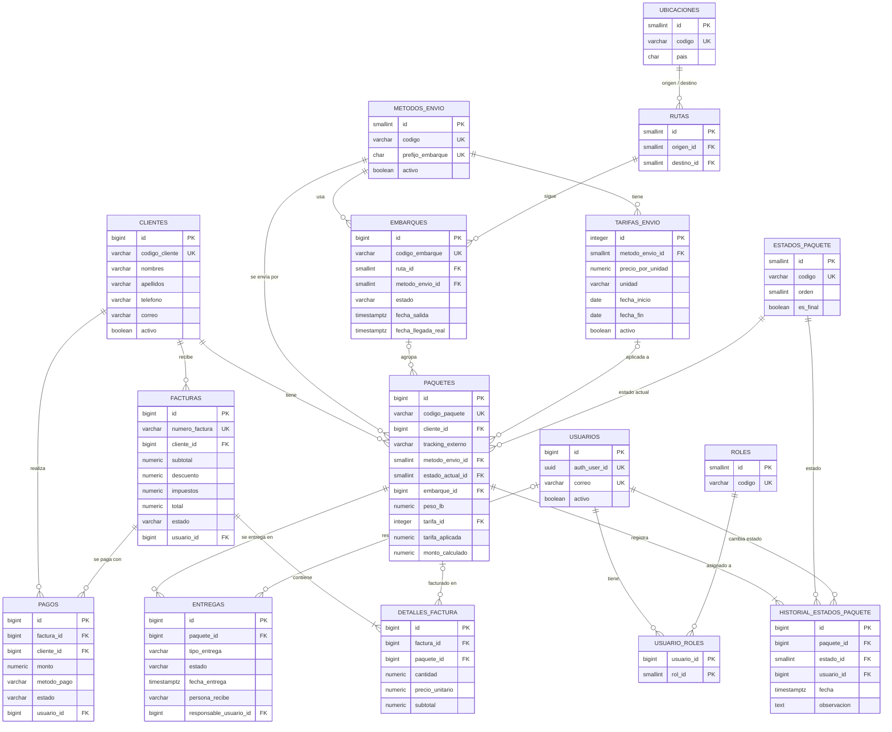

# Modelo de dominio y de datos — v1

> **Extensión contable (2026-11-01):** el libro diario, gastos y estados financieros
> en NIO se describen en [contabilidad.md](contabilidad.md). Se implementan mediante
> una migración nueva, conservando el Baseline congelado y las reglas operativas.

**Estado:** revisado y cerrado para v1 · **Fecha:** 2026-09-29

> **Multi-agencia (esquema v2):** el sistema es ahora un SaaS con varias agencias. Todas las tablas de
> este modelo, salvo los catálogos (`estados_paquete`, `roles`, `metodos_envio`), tienen `agencia_id`,
> RLS y claves foráneas compuestas; los códigos y correlativos son por agencia. Lo que cambia respecto
> de este documento está en `docs/diseno-multiagencia.md`, que prevalece en lo que toca a agencias. Las
> reglas del negocio de este documento siguen iguales dentro de cada agencia.

Archivos relacionados:

| Archivo | Contenido |
|---|---|
| `database/schema.sql` | Esquema PostgreSQL completo: tablas, restricciones, índices, triggers, rol de la API y catálogos del sistema |
| `database/seed.sql` | Configuración inicial del negocio: métodos de envío, ubicaciones, ruta y tarifa de ejemplo |
| `database/tests/flujo_completo.sql` | Prueba del flujo Cliente → Entrega, de 39 operaciones inválidas del negocio y de 65 intentos de borrado. Cada rechazo se valida por SQLSTATE y por su razón. Se revierte al final, no deja datos |

El esquema se probó en PostgreSQL 16, como superusuario y como dueño **no** superusuario (igual que el usuario `postgres` de Supabase): carga sin errores y la prueba pasa completa. El flujo de la prueba corre con el rol de la API, `paqueteria_api`.

### Cambios de la revisión

1. Un paquete solo puede crearse en `REGISTRADO`, sin embarque, cálculo ni fechas de recepción.
2. Las invariantes Factura ↔ Cliente ↔ Paquete también se protegen ante `UPDATE`.
3. Facturas, líneas de factura y pagos son financieramente inmutables; el cuadre de la factura lo verifica la BD.
4. La política de no borrado se aplica en todas las tablas, en dos capas: el rol de la API no tiene `DELETE` ni `TRUNCATE`, y triggers bloquean ambas operaciones incluso para el dueño.
5. La prueba valida el SQLSTATE y la razón de cada rechazo, no solo que la operación falle.

---

## 1. Alcance

**Entidades de este modelo (13):** Cliente, Paquete, Embarque, MétodoEnvío, TarifaEnvío, EstadoPaquete, HistorialEstadoPaquete, Factura, DetalleFactura, Pago, Entrega, Usuario, Rol.

**Entidades de soporte (3):**

- **Ubicación** y **Ruta**: Embarque necesita una ruta (Miami → Managua). Se modelan en su forma mínima.
- **Correlativos**: tabla técnica para numerar facturas y embarques sin huecos.
- **UsuarioRol**: tabla intermedia de la relación N:M entre Usuario y Rol.

**Fuera de esta iteración:** Permiso y Auditoría (`AuditLogs`). Se diseñan en la siguiente iteración; el modelo ya las prepara porque todas las operaciones guardan qué usuario las hizo.

---

## 2. Decisiones de diseño

1. **El historial es la fuente de verdad del estado del paquete.** `paquetes.estado_actual_id` es una copia para consultas rápidas. La única forma de cambiar el estado es insertar una fila en `historial_estados_paquete`; un trigger actualiza el estado actual y las fechas de recepción. Un `UPDATE` directo al estado se rechaza. Así el historial nunca queda incompleto.
2. **El estado de pago de una factura se deriva, no se guarda.** `facturas.estado` solo dice si el documento está `EMITIDA` o `ANULADA`. Saldo y estado de pago (`PENDIENTE` / `PARCIAL` / `PAGADA`) salen de la vista `v_facturas_saldo`, calculados desde los pagos. No pueden contradecirse.
3. **El paquete guarda una copia de la tarifa que se le aplicó** (`tarifa_aplicada`) además de la referencia (`tarifa_id`). Si mañana cambia la tarifa, el monto de los paquetes ya calculados no cambia.
4. **Coherencia del método de envío garantizada por la BD.** Un paquete aéreo no puede entrar a un embarque marítimo ni recibir una tarifa marítima. Se resuelve con claves foráneas compuestas, sin código.
5. **Números de factura consecutivos, sin huecos.** Las secuencias de PostgreSQL saltan números cuando una transacción falla; para facturas se usa un contador que se revierte con la transacción. Los códigos de cliente y paquete sí usan secuencias (un hueco ahí no importa).
6. **Esquema propio `paqueteria`, fuera de `public`.** Supabase expone `public` automáticamente en su API REST. Usar otro esquema asegura que solo la API ASP.NET Core accede a los datos.
7. **Las contraseñas las gestiona Supabase Auth.** `usuarios.auth_user_id` guarda el `sub` del JWT; la tabla no tiene columnas de contraseña.
8. **Sin borrado físico, en dos capas.** Clientes, usuarios, tarifas y métodos se desactivan (`activo = false`). Paquetes se cancelan (estado `CANCELADO`). Facturas y pagos se anulan con motivo. La API se conecta con el rol `paqueteria_api`, que no tiene privilegios de `DELETE` ni `TRUNCATE`; además, triggers bloquean ambas operaciones en todas las tablas del negocio, también para el dueño del esquema. Única excepción: `usuario_roles`, porque quitar un rol es una operación normal.
9. **Un documento financiero emitido no se edita.** Facturas, sus líneas y los pagos no cambian después de registrados; solo admiten su anulación. Una corrección es siempre "anular y volver a emitir", así el historial financiero queda completo.
10. **Un paquete nace siempre en `REGISTRADO`.** No puede crearse saltándose etapas del flujo.

---

## 3. Entidades y atributos

Convenciones de tipos: dinero `NUMERIC(18,2)` · tarifas `NUMERIC(12,4)` · peso `NUMERIC(10,2)` en libras · fechas-hora `TIMESTAMPTZ` · enumeraciones cerradas `VARCHAR` + `CHECK`. **Req.** = obligatorio (NOT NULL).

### 3.1 Cliente — `clientes`

Persona que envía paquetes a través de la agencia.

| Atributo | Tipo | Req. | Notas |
|---|---|---|---|
| id | bigint | ✓ | PK |
| codigo_cliente | varchar(20) | ✓ | Único. Automático: `CLI-000001` |
| nombres | varchar(100) | ✓ | No vacío |
| apellidos | varchar(100) | ✓ | No vacío |
| telefono | varchar(30) | ✓ | Obligatorio porque es el canal para notificar |
| correo | varchar(254) | | |
| direccion | text | | Dirección habitual (la de cada delivery se guarda en la entrega) |
| activo | boolean | ✓ | Activar/desactivar en lugar de borrar |
| fecha_registro | timestamptz | ✓ | |
| actualizado_en | timestamptz | ✓ | Automático |

Índices para búsqueda: nombre completo (trigramas, sirve para `ILIKE '%lópez%'`), teléfono y correo.

### 3.2 Paquete — `paquetes`

Un paquete de un cliente, desde que se registra hasta que se entrega.

| Atributo | Tipo | Req. | Notas |
|---|---|---|---|
| id | bigint | ✓ | PK |
| codigo_paquete | varchar(20) | ✓ | Único. Automático: `PKG-000001` |
| cliente_id | bigint | ✓ | FK → clientes |
| tracking_externo | varchar(100) | | Tracking de Amazon/courier. No puede repetirse entre paquetes no cancelados (sin distinguir mayúsculas) |
| tienda | varchar(100) | | |
| descripcion | text | ✓ | |
| metodo_envio_id | smallint | ✓ | FK → metodos_envio |
| estado_actual_id | smallint | ✓ | FK → estados_paquete. Inicia en `REGISTRADO`. Solo cambia vía historial |
| embarque_id | bigint | | FK → embarques. Debe ser del mismo método de envío |
| peso_lb | numeric(10,2) | | > 0. Se registra en Nicaragua |
| tarifa_id | integer | | FK → tarifas_envio. Debe ser del mismo método de envío |
| tarifa_aplicada | numeric(12,4) | | Copia del precio por libra al calcular |
| monto_calculado | numeric(18,2) | | ≥ 0 |
| registrado_por_usuario_id | bigint | ✓ | FK → usuarios |
| fecha_registro | timestamptz | ✓ | |
| fecha_recepcion_miami | timestamptz | | La llena el historial al pasar a `RECIBIDO_EN_MIAMI` |
| fecha_recepcion_nicaragua | timestamptz | | La llena el historial al pasar a `RECIBIDO_EN_NICARAGUA` |
| actualizado_en | timestamptz | ✓ | Automático |

Reglas:

- **Alta:** el paquete se crea en `REGISTRADO`, sin embarque, peso, tarifa, monto ni fechas de recepción. La API no debe enviar `estado_actual_id` (o enviar 1).
- **Cálculo:** tarifa, tarifa aplicada y monto se guardan los tres juntos o ninguno, y exigen peso.
- **Estado y fechas de recepción:** no se editan con `UPDATE`; los produce el historial.
- **Paquete facturado:** mientras esté en una factura vigente, su cliente, método, peso, tarifa y monto quedan congelados. Para corregirlos hay que anular la factura.

### 3.3 Estado de paquete — `estados_paquete`

Catálogo fijo del sistema. Los `id` son estables y el backend los conoce: **no renumerar**.

| Atributo | Tipo | Req. | Notas |
|---|---|---|---|
| id | smallint | ✓ | PK, asignado a mano (1–11) |
| codigo | varchar(30) | ✓ | Único |
| nombre | varchar(60) | ✓ | Texto para la interfaz |
| descripcion | text | | |
| orden | smallint | ✓ | Único. Orden de presentación |
| es_final | boolean | ✓ | Un paquete en estado final no puede cambiar de estado |

| id | código | final |
|---|---|---|
| 1 | REGISTRADO | |
| 2 | RECIBIDO_EN_MIAMI | |
| 3 | PENDIENTE_DE_ENVIO | |
| 4 | EN_TRANSITO | |
| 5 | RECIBIDO_EN_NICARAGUA | |
| 6 | PENDIENTE_DE_PAGO | |
| 7 | PAGADO | |
| 8 | LISTO_PARA_ENTREGA | |
| 9 | EN_REPARTO | |
| 10 | ENTREGADO | ✓ |
| 11 | CANCELADO | ✓ |

### 3.4 Historial de estado — `historial_estados_paquete`

Cada cambio de estado de un paquete. Inmutable: no admite `UPDATE` ni `DELETE`.

| Atributo | Tipo | Req. | Notas |
|---|---|---|---|
| id | bigint | ✓ | PK |
| paquete_id | bigint | ✓ | FK → paquetes |
| estado_id | smallint | ✓ | FK → estados_paquete. Estado al que pasa |
| usuario_id | bigint | ✓ | FK → usuarios. Quién hizo el cambio |
| fecha | timestamptz | ✓ | |
| observacion | text | | Ej.: "Entrega fallida: nadie en casa" |

Al crear un paquete se inserta automáticamente la primera fila (`REGISTRADO`).

### 3.5 Embarque — `embarques`

Agrupa paquetes que viajan juntos por la misma ruta y método.

| Atributo | Tipo | Req. | Notas |
|---|---|---|---|
| id | bigint | ✓ | PK |
| codigo_embarque | varchar(20) | ✓ | Único. Automático: `AIR-2026-0001`, `SEA-2026-0001`. El correlativo reinicia cada año (hora de Managua) |
| ruta_id | smallint | ✓ | FK → rutas |
| metodo_envio_id | smallint | ✓ | FK → metodos_envio |
| estado | varchar(20) | ✓ | `ABIERTO`, `CERRADO`, `EN_TRANSITO`, `RECIBIDO`, `CANCELADO` |
| fecha_salida | timestamptz | | Obligatoria en `EN_TRANSITO` y `RECIBIDO` |
| fecha_llegada_estimada | date | | |
| fecha_llegada_real | timestamptz | | Obligatoria en `RECIBIDO`; no puede ser anterior a la salida |
| observaciones | text | | |
| creado_por_usuario_id | bigint | ✓ | FK → usuarios |
| creado_en / actualizado_en | timestamptz | ✓ | |

### 3.6 Método de envío — `metodos_envio`

| Atributo | Tipo | Req. | Notas |
|---|---|---|---|
| id | smallint | ✓ | PK |
| codigo | varchar(20) | ✓ | Único: `AEREO`, `MARITIMO` |
| nombre | varchar(50) | ✓ | |
| prefijo_embarque | char(3) | ✓ | Único: `AIR`, `SEA`. Se usa en el código del embarque |
| descripcion | text | | |
| activo | boolean | ✓ | |
| creado_en / actualizado_en | timestamptz | ✓ | |

### 3.7 Tarifa — `tarifas_envio`

Precio por unidad de un método de envío durante un período.

| Atributo | Tipo | Req. | Notas |
|---|---|---|---|
| id | integer | ✓ | PK |
| metodo_envio_id | smallint | ✓ | FK → metodos_envio |
| precio_por_unidad | numeric(12,4) | ✓ | > 0 |
| unidad | varchar(10) | ✓ | `LB` (única permitida en v1) |
| moneda | char(3) | ✓ | `USD` (única permitida en v1) |
| fecha_inicio | date | ✓ | |
| fecha_fin | date | | Inclusiva. Vacía = vigente sin fin |
| activo | boolean | ✓ | |
| creado_por_usuario_id | bigint | | FK → usuarios |
| creado_en / actualizado_en | timestamptz | ✓ | |

Regla: dos tarifas **activas** del mismo método no pueden tener vigencias que se traslapen, así la tarifa vigente es siempre una sola. La función `fn_tarifa_vigente(metodo, fecha)` la devuelve.

Para cambiar una tarifa: cerrar la actual poniendo `fecha_fin` y crear la nueva desde el día siguiente.

### 3.8 Factura — `facturas`

| Atributo | Tipo | Req. | Notas |
|---|---|---|---|
| id | bigint | ✓ | PK |
| numero_factura | varchar(20) | ✓ | Único. Automático y consecutivo sin huecos: `FAC-000001` |
| cliente_id | bigint | ✓ | FK → clientes |
| fecha | timestamptz | ✓ | |
| moneda | char(3) | ✓ | `USD` |
| subtotal | numeric(18,2) | ✓ | ≥ 0 |
| descuento | numeric(18,2) | ✓ | ≥ 0 y ≤ subtotal |
| impuestos | numeric(18,2) | ✓ | ≥ 0 |
| total | numeric(18,2) | ✓ | Debe ser `subtotal − descuento + impuestos` |
| estado | varchar(20) | ✓ | `EMITIDA` o `ANULADA` |
| motivo_anulacion | text | | Obligatorio si está anulada |
| anulada_en | timestamptz | | Obligatorio si está anulada |
| usuario_id | bigint | ✓ | FK → usuarios. Quién la emitió |
| creado_en / actualizado_en | timestamptz | ✓ | |

**Vista `v_facturas_saldo`:** `pagado`, `saldo` y `estado_pago` (`PENDIENTE`, `PARCIAL`, `PAGADA`, `ANULADA`) por factura.

Reglas de una factura emitida:

- **Inmutable:** número, cliente, fecha, moneda, montos y usuario no cambian nunca.
- **Cuadre:** al confirmar la transacción, la factura debe tener al menos una línea y la suma de sus líneas debe ser igual a su subtotal. La verificación es diferida (se ejecuta en el `COMMIT`), así que **factura y líneas se crean en la misma transacción**. Una línea agregada después descuadra la factura y se rechaza.
- **Anulación:** única transición permitida, `EMITIDA → ANULADA`, con motivo y fecha, y solo si no tiene pagos aplicados (se anulan primero). Una factura anulada ya no cambia ni vuelve a `EMITIDA`.

### 3.9 Detalle de factura — `detalles_factura`

| Atributo | Tipo | Req. | Notas |
|---|---|---|---|
| id | bigint | ✓ | PK |
| factura_id | bigint | ✓ | FK → facturas |
| paquete_id | bigint | | FK → paquetes. Vacío para cargos futuros no ligados a un paquete (delivery, almacenaje) |
| descripcion | varchar(200) | ✓ | Ej.: "Envío aéreo PKG-000001" |
| cantidad | numeric(10,2) | ✓ | > 0. Libras facturadas (o 1 para cargos fijos) |
| precio_unitario | numeric(12,4) | ✓ | > 0. Tarifa por libra |
| subtotal | numeric(18,2) | ✓ | > 0. Debe ser `round(cantidad × precio_unitario, 2)` |

Reglas: un paquete solo puede estar en **una factura vigente** (no anulada); el paquete debe ser del mismo cliente que la factura; no se agregan líneas a facturas anuladas; las líneas no se modifican ni se borran.

### 3.10 Pago — `pagos`

| Atributo | Tipo | Req. | Notas |
|---|---|---|---|
| id | bigint | ✓ | PK |
| factura_id | bigint | ✓ | FK → facturas |
| cliente_id | bigint | ✓ | FK → clientes. Debe coincidir con el cliente de la factura |
| monto | numeric(18,2) | ✓ | > 0. Lo abonado a la factura, **en USD** |
| moneda | char(3) | ✓ | `USD` o `NIO` (moneda en que se recibió). Por defecto `USD`. *Migración PagosEnCordobas* |
| monto_moneda | numeric(18,2) | | Córdobas recibidos. Vacío si fue en USD |
| tipo_cambio_aplicado | numeric(12,4) | | Copia del tipo de cambio (NIO por USD) usado. Vacío si fue en USD |
| metodo_pago | varchar(20) | ✓ | `EFECTIVO`, `TRANSFERENCIA`, `TARJETA`, `OTRO` |
| referencia | varchar(100) | | Número de transferencia o voucher |
| fecha | timestamptz | ✓ | |
| estado | varchar(20) | ✓ | `APLICADO` o `ANULADO` |
| motivo_anulacion / anulado_en | text / timestamptz | | Obligatorios si está anulado |
| usuario_id | bigint | ✓ | FK → usuarios. Quién registró el pago |
| creado_en / actualizado_en | timestamptz | ✓ | |

Pagos en córdobas: `monto = round(monto_moneda / tipo_cambio_aplicado, 2)` (`ck_pagos_moneda`); en USD, `monto_moneda` y `tipo_cambio_aplicado` van vacíos. La factura sigue en USD, así saldo y estado de pago no cambian de cálculo. Pagar en córdobas el saldo convertido (`round(saldo × tipo, 2)`) lo salda exacto.

Reglas: se admiten varios pagos por factura (pagos parciales); la suma de pagos aplicados no puede superar el total; no se paga una factura anulada. Un pago registrado es inmutable: solo admite `APLICADO → ANULADO` con motivo y fecha, y un pago anulado no vuelve a aplicarse. Si hubo un error, se anula y se registra otro.

### 3.10.1 Tipo de cambio — `tipos_cambio` (migración PagosEnCordobas)

Córdobas por dólar de cada día, registrado por el administrador (p. ej. el oficial del BCN).

| Atributo | Tipo | Req. | Notas |
|---|---|---|---|
| id | integer | ✓ | PK |
| fecha | date | ✓ | Única. Puede ser futura (tabla del mes cargada por adelantado) |
| nio_por_usd | numeric(12,4) | ✓ | > 0 |
| creado_por_usuario_id | bigint | ✓ | FK → usuarios |
| creado_en / actualizado_en | timestamptz | ✓ | |

El vigente para un pago es el más reciente con `fecha` ≤ hoy en Managua. Corregir un día no altera pagos ya registrados (cada pago guarda su copia). Sin borrado físico, como el resto de tablas.

### 3.11 Entrega — `entregas`

Un intento de entrega de un paquete. Un paquete puede tener varios intentos (uno fallido y luego uno exitoso), pero **solo uno vigente** a la vez.

| Atributo | Tipo | Req. | Notas |
|---|---|---|---|
| id | bigint | ✓ | PK |
| paquete_id | bigint | ✓ | FK → paquetes |
| tipo_entrega | varchar(20) | ✓ | `RETIRO_EN_AGENCIA` o `DELIVERY` |
| direccion | text | | Obligatoria para `DELIVERY` |
| estado | varchar(20) | ✓ | `PENDIENTE`, `EN_RUTA`, `ENTREGADA`, `FALLIDA`, `CANCELADA` |
| fecha_programada | timestamptz | | |
| fecha_entrega | timestamptz | | Obligatoria en `ENTREGADA` |
| persona_recibe | varchar(150) | | Obligatoria en `ENTREGADA` |
| responsable_usuario_id | bigint | | FK → usuarios (repartidor). Obligatorio en `EN_RUTA` |
| observaciones | text | | |
| creado_por_usuario_id | bigint | ✓ | FK → usuarios |
| creado_en / actualizado_en | timestamptz | ✓ | |

`EN_RUTA` solo aplica a `DELIVERY`. Un retiro en agencia pasa de `PENDIENTE` a `ENTREGADA`.

### 3.12 Usuario — `usuarios`

Empleado con acceso al sistema.

| Atributo | Tipo | Req. | Notas |
|---|---|---|---|
| id | bigint | ✓ | PK |
| auth_user_id | uuid | | Único. `sub` del JWT de Supabase Auth. Vacío hasta que el usuario acepta la invitación |
| nombres / apellidos | varchar(100) | ✓ | |
| correo | varchar(254) | ✓ | Único sin distinguir mayúsculas |
| telefono | varchar(30) | | |
| activo | boolean | ✓ | Un usuario inactivo no debe poder operar aunque su token sea válido |
| creado_en / actualizado_en | timestamptz | ✓ | |

### 3.13 Rol — `roles` y `usuario_roles`

| Atributo | Tipo | Req. | Notas |
|---|---|---|---|
| id | smallint | ✓ | PK |
| codigo | varchar(30) | ✓ | Único: `ADMIN`, `AGENTE`, `BODEGA`, `REPARTIDOR` |
| nombre | varchar(60) | ✓ | |
| descripcion | text | | |
| activo | boolean | ✓ | |

`usuario_roles (usuario_id, rol_id, asignado_en)` con PK compuesta. Un usuario puede tener varios roles (en una agencia pequeña, un agente también recibe en bodega).

### 3.14 Soporte — `ubicaciones` y `rutas`

- `ubicaciones`: id, codigo (único: `MIA`, `MGA`), nombre, pais (ISO de 2 letras), activo.
- `rutas`: id, origen_id, destino_id (FK → ubicaciones, distintos entre sí, par único), nombre, activo.

---

## 4. Relaciones y cardinalidades

| # | Relación | Cardinalidad | Cómo se implementa | Significado |
|---|---|---|---|---|
| R1 | Cliente — Paquete | 1 : 0..N | `paquetes.cliente_id` | Un cliente tiene muchos paquetes; cada paquete es de un solo cliente |
| R2 | MétodoEnvío — Paquete | 1 : 0..N | `paquetes.metodo_envio_id` | Cada paquete viaja por un método |
| R3 | EstadoPaquete — Paquete | 1 : 0..N | `paquetes.estado_actual_id` | Estado actual (copia del último historial) |
| R4 | Paquete — HistorialEstado | 1 : 1..N | `historial.paquete_id` | Todo paquete tiene al menos su registro inicial |
| R5 | EstadoPaquete — HistorialEstado | 1 : 0..N | `historial.estado_id` | |
| R6 | Embarque — Paquete | 0..1 : 0..N | `paquetes.embarque_id` (FK compuesta con el método) | Un embarque agrupa muchos paquetes; un paquete está en un embarque o en ninguno todavía |
| R7 | MétodoEnvío — Embarque | 1 : 0..N | `embarques.metodo_envio_id` | |
| R8 | Ruta — Embarque | 1 : 0..N | `embarques.ruta_id` | |
| R9 | Ubicación — Ruta | 1 : 0..N (dos veces) | `rutas.origen_id`, `rutas.destino_id` | Cada ruta tiene un origen y un destino |
| R10 | MétodoEnvío — Tarifa | 1 : 0..N | `tarifas_envio.metodo_envio_id` | Historial de tarifas por método; una sola vigente por fecha |
| R11 | Tarifa — Paquete | 0..1 : 0..N | `paquetes.tarifa_id` (FK compuesta con el método) | Tarifa aplicada al calcular el monto |
| R12 | Cliente — Factura | 1 : 0..N | `facturas.cliente_id` | |
| R13 | Factura — DetalleFactura | 1 : 1..N | `detalles_factura.factura_id` | Mínimo una línea; la suma de líneas es el subtotal (lo verifica la BD al confirmar) |
| R14 | Paquete — DetalleFactura | 0..1 : 0..N | `detalles_factura.paquete_id` | Un paquete puede aparecer en varias facturas solo si las anteriores están anuladas; **como máximo una vigente** |
| R15 | Factura — Pago | 1 : 0..N | `pagos.factura_id` | Pagos parciales permitidos |
| R16 | Cliente — Pago | 1 : 0..N | `pagos.cliente_id` (FK compuesta con la factura) | |
| R17 | Paquete — Entrega | 1 : 0..N | `entregas.paquete_id` | Varios intentos; **como máximo uno vigente** |
| R18 | Usuario — Entrega (responsable) | 0..1 : 0..N | `entregas.responsable_usuario_id` | Repartidor asignado |
| R19 | Usuario — Rol | N : M | `usuario_roles` | |
| R20 | Usuario — operaciones | 1 : 0..N | `*_usuario_id` en paquetes, historial, embarques, tarifas, facturas, pagos, entregas | Trazabilidad: quién hizo cada operación |

La relación de negocio "una factura cubre varios paquetes" es N:M entre Factura y Paquete, resuelta por DetalleFactura.

---

## 5. Diagrama entidad-relación

Por legibilidad el diagrama omite las columnas de auditoría (`creado_en`, `actualizado_en`) y las relaciones de trazabilidad con Usuario (R20) salvo las principales.

---

## 6. Ciclo de vida del paquete

Transiciones permitidas. La BD garantiza que todo cambio quede en el historial y que no se salga de un estado final; **qué transición está permitida lo valida el backend**.

| Desde | Hacia | Evento | Rol |
|---|---|---|---|
| REGISTRADO | RECIBIDO_EN_MIAMI | Llega a la bodega | Bodega |
| RECIBIDO_EN_MIAMI | PENDIENTE_DE_ENVIO | Se asigna a un embarque | Bodega |
| PENDIENTE_DE_ENVIO | RECIBIDO_EN_MIAMI | Se quita de un embarque todavía `ABIERTO` (error al asignar, no cabe) | Bodega |
| PENDIENTE_DE_ENVIO | EN_TRANSITO | El embarque registra su salida (todos sus paquetes a la vez) | Bodega |
| EN_TRANSITO | RECIBIDO_EN_NICARAGUA | El embarque registra su llegada | Bodega |
| RECIBIDO_EN_NICARAGUA | PENDIENTE_DE_PAGO | Se registra peso y se calcula el monto | Bodega |
| PENDIENTE_DE_PAGO | PAGADO | La factura que lo incluye queda con saldo 0 | Agente (automático al registrar el pago) |
| PENDIENTE_DE_PAGO | LISTO_PARA_ENTREGA | Preparado para entrega **contra entrega**: exige factura emitida (vigente) | Agente / Bodega |
| PAGADO | PENDIENTE_DE_PAGO | Se anula un pago de su factura y deja de estar saldada (solo si el paquete sigue en `PAGADO`) | Administrador |
| PAGADO | LISTO_PARA_ENTREGA | Preparado para retiro o delivery | Agente / Bodega |
| LISTO_PARA_ENTREGA | ENTREGADO | Retiro en agencia | Agente |
| LISTO_PARA_ENTREGA | EN_REPARTO | Sale con un repartidor | Agente / Repartidor |
| EN_REPARTO | ENTREGADO | Delivery confirmado | Repartidor |
| EN_REPARTO | LISTO_PARA_ENTREGA | Delivery fallido | Repartidor |
| REGISTRADO, RECIBIDO_EN_MIAMI, PENDIENTE_DE_ENVIO | CANCELADO | Anulación | Administrador / Agente |

**Pago contra entrega** (pregunta abierta 5, respondida el 2026-09-29): un paquete puede prepararse y salir a entrega sin pagar si ya tiene su factura emitida. Reglas del backend:

- Ningún paquete pasa a `ENTREGADO` sin su factura vigente **saldada** (retiro en agencia y delivery).
- Al confirmar un delivery de paquetes sin pagar se cobra, en la misma transacción, el **saldo completo** de sus facturas (USD o córdobas); sin cobro completo, el delivery se marca fallido.
- Al saldar una factura solo pasan a `PAGADO` los paquetes que siguen en `PENDIENTE_DE_PAGO`; los que ya están en entrega conservan su estado.
- Un pago se puede anular salvo que algún paquete de la factura esté `ENTREGADO`. Una factura no se anula si alguno de sus paquetes ya se preparó para entrega.
- El REPARTIDOR solo cobra al confirmar una entrega, no por el endpoint general de pagos.

**Entrega agrupada** (pregunta abierta 8): la API programa, confirma o marca fallidos varios paquetes del mismo cliente en una sola operación; en la BD sigue habiendo una fila de `entregas` por paquete.

Ciclo del embarque: `ABIERTO` (recibe paquetes) → `CERRADO` (consolidado) → `EN_TRANSITO` → `RECIBIDO`. `CANCELADO` solo si no tiene paquetes (lo valida el backend). Un embarque cerrado no se reabre; mientras está `ABIERTO` se le pueden quitar paquetes.

---

## 7. Dónde vive cada regla

**Garantizado por la base de datos** (cada caso probado en `tests/flujo_completo.sql`, con su SQLSTATE):

*Paquetes y estados*

- Crear un paquete en un estado distinto de `REGISTRADO`, o con embarque, cálculo o fechas de recepción.
- Cambiar el estado o las fechas de recepción sin pasar por el historial.
- Modificar el historial; cambiar el estado de un paquete entregado o cancelado.
- Registrar dos veces el mismo tracking externo.
- Poner un paquete en un embarque o tarifa de otro método de envío; guardar un cálculo incompleto.
- Dos tarifas activas del mismo método con vigencias traslapadas.

*Facturas, paquetes y clientes*

- Facturar dos veces el mismo paquete, o el paquete de otro cliente.
- Cambiar el cliente, método, peso, tarifa o monto de un paquete que está en una factura vigente.
- Cambiar el cliente, número, fecha o montos de una factura; modificar sus líneas.
- Facturas cuyo total no cuadra; líneas cuyo subtotal no es cantidad × precio.
- Facturas sin líneas o cuyas líneas no suman el subtotal (al confirmar); agregar líneas a una factura ya emitida o anulada.
- Anular sin motivo; anular una factura con pagos aplicados; reactivar una factura anulada.

*Pagos*

- Pagar más que el saldo, pagar una factura anulada, registrar el pago a nombre de otro cliente.
- Cambiar monto, factura o cualquier dato de un pago; reactivar un pago anulado.

*Entregas y embarques*

- Delivery sin dirección; entrega confirmada sin fecha o sin persona que recibe; dos entregas vigentes para un paquete.
- Embarques en tránsito sin fecha de salida o con llegada anterior a la salida.

*Borrado*

- `DELETE` o `TRUNCATE` en cualquier tabla del negocio: el rol de la API no tiene el privilegio (`42501`) y los triggers lo impiden incluso al dueño (`23001`).

**Responsabilidad del backend:**

- Qué transiciones de estado están permitidas (tabla de la sección 6) y qué rol puede hacer cada una.
- Cálculo del monto: `round(peso × tarifa, 2)`. Ver nota de redondeo en la sección 8.
- Calcular el subtotal, descuento, impuestos y total de la factura (la BD verifica que cuadren).
- Pasar los paquetes a `PAGADO` cuando `v_facturas_saldo.estado_pago = 'PAGADA'`, en la misma transacción que el pago.
- Registrar el pago y el cambio de estado juntos; salida y llegada del embarque junto con el estado de sus paquetes.
- Verificar que el usuario esté `activo` además de validar el JWT.
- Permisos por rol y auditoría (siguiente iteración).

---

## 8. Notas para la implementación

**Conexión y roles**

- La API se conecta con un usuario de login miembro de `paqueteria_api` (solo `SELECT`, `INSERT`, `UPDATE`; `DELETE` únicamente en `usuario_roles`). Se crea fuera del script para que la contraseña no llegue al repositorio; `schema.sql` (sección 17) trae el comando.
- Las migraciones de EF Core corren con el dueño del esquema (otra cadena de conexión, solo en el pipeline de despliegue). Los privilegios por defecto hacen que las tablas nuevas hereden los permisos de `paqueteria_api`.

**Entity Framework Core (Npgsql)**

- Usar `EFCore.NamingConventions` con `UseSnakeCaseNamingConvention()` para que `CodigoCliente` mapee a `codigo_cliente`, y `modelBuilder.HasDefaultSchema("paqueteria")`.
- Fuente de verdad del esquema: generar la migración inicial con EF y agregar funciones, triggers, la exclusión de tarifas, las políticas de borrado y el rol con `migrationBuilder.Sql(...)` tomando el SQL de `schema.sql`. Desde ahí, todo cambio va por migraciones.
- Columnas que llena la BD: `codigo_cliente`, `codigo_paquete`, `codigo_embarque`, `numero_factura` (`ValueGeneratedOnAdd`) y `estado_actual_id`, `fecha_recepcion_miami`, `fecha_recepcion_nicaragua` (las cambia un trigger: recargar la entidad después de insertar historial). Al crear un paquete no asignar `EstadoActualId`.
- Para cambiar el estado de un paquete, agregar una entidad `HistorialEstadoPaquete`; nunca asignar `Paquete.EstadoActualId`.
- **Factura y líneas en una sola transacción:** agregarlas al contexto y llamar `SaveChanges` una vez (o usar una transacción explícita). Si se guardan en dos `SaveChanges` sin transacción, el primer `COMMIT` falla porque la factura no tiene líneas.
- Para anular una factura o un pago, actualizar solo `Estado`, `MotivoAnulacion` y `AnuladaEn`/`AnuladoEn`. Cualquier otro cambio en esas entidades se rechaza.
- Redondeo: `round()` de PostgreSQL redondea los medios hacia arriba (7.865 → 7.87), pero `Math.Round` de C# por defecto redondea al par (7.865 → 7.86). Usar siempre `Math.Round(valor, 2, MidpointRounding.AwayFromZero)` para que el backend y la BD den el mismo resultado.
- Los errores de reglas de la BD llegan como `PostgresException` (en `SaveChanges`, envueltos en `DbUpdateException`). Mapear `SqlState` a HTTP:

| SQLSTATE | Significado | HTTP |
|---|---|---|
| `23505` | Duplicado (tracking, paquete ya facturado, entrega vigente) | 409 |
| `23P01` | Tarifa con vigencia traslapada | 409 |
| `23001` | Operación prohibida: borrar o modificar algo inmutable | 409 |
| `23514` | Regla de negocio sobre los valores | 400. Los conflictos de estado (anular una factura con pagos, pagar una factura anulada, cambiar un estado final, etc.) los valida antes el backend y responde 409; si uno llega a la BD, la regla sigue protegida y la respuesta es 400 |
| `23503` | Referencia inválida (incluye método de envío que no coincide) | 400 |
| `42501` | Falta de privilegio: indica un error de programación, no del usuario | 500 y alerta |
| — | La BD no respondió (`NpgsqlException` sin SQLSTATE: conexión rechazada, timeout) | 503 |

**Supabase**

- Activar las extensiones `btree_gist` y `pg_trgm` (el script lo intenta con `create extension`).
- No agregar el esquema `paqueteria` a "Exposed schemas" en la configuración de la API: así la Data API no lo publica.
- Guardar las cadenas de conexión solo en variables de entorno o secretos del hosting, nunca en el repositorio.

---

## 9. Preguntas abiertas para la agencia

Estas respuestas pueden cambiar el modelo; conviene resolverlas antes de implementar paquetes y tarifas.

1. **Marítimo: ¿se cobra por libra o por pie cúbico?** Si es por pie³, hay que registrar dimensiones del paquete y agregar la unidad `PIE3` a las tarifas.
2. ~~**Moneda:** ¿todo se cobra en USD?~~ **Respondida (2026-09-29):** se aceptan pagos en dólares y córdobas. Facturas en USD; el pago guarda moneda y tipo de cambio (migración PagosEnCordobas, `tipos_cambio` diario del administrador).
3. **Redondeo de peso y mínimos:** ¿se cobra la libra completa (4.2 lb → 5 lb)? ¿Hay un cobro mínimo por paquete?
4. **Paquetes sin aviso:** ¿qué pasa si llega a Miami un paquete que el cliente no informó? Hoy `cliente_id` es obligatorio; quizá haga falta un estado "sin identificar".
5. ~~**Pago contra entrega:**~~ **Respondida (2026-09-29):** sí. Ver "Pago contra entrega" en la sección 6.
6. **Factura fiscal:** **Respondida en parte (2026-09-29):** la factura del sistema es un **comprobante interno** (`FAC-000001`); si la agencia entrega factura fiscal, la hace aparte con su serie DGI. El monto es peso × tarifa y se asume que **la tarifa ya incluye el IVA** (`impuestos = 0`). **Pendiente confirmar con el contador de la agencia** que la tarifa incluye IVA.
7. **Identificación del cliente:** ¿aduana o la agencia necesitan la cédula del cliente?
8. ~~**Delivery agrupado:**~~ **Respondida (2026-09-29):** sí, agrupado en la API (una fila de `entregas` por paquete). Ver sección 6.

---

## 10. Siguiente iteración

- ~~**Diseño e implementación del backend:** solución .NET, proyectos y capas, entidades EF Core, `DbContext` y migración inicial a partir de este esquema.~~ **Implementado (2026-09-29):** solución .NET 10 completa con esquema v2 multi-agencia (`Baseline`), todos los módulos operativos y administrativos, y 409 pruebas automatizadas. Ver `CLAUDE.md` y `docs/diseno-multiagencia.md`.
- **Próximo paso:** configuración de Supabase Auth y construcción del frontend (`frontend/`). Ver la sección **Siguientes pasos** en `CLAUDE.md`.
- **Permiso** y **RolPermiso** (N:M) para autorización fina por acción (pendiente de decidir si hace falta más allá de los roles actuales).
- ~~**Auditoría** (`audit_logs`)~~ **Implementada (2026-09-29, migración Auditoria / integrada en Baseline v2):** trigger `fn_auditar` en todas las tablas del negocio (salvo `correlativos` e `historial_estados_paquete`); guarda tabla, id del registro, acción, valores anteriores y nuevos (JSONB, en UPDATE solo lo que cambió), usuario, origen de la solicitud, traceId y fecha. Inmutable. Captura también los cambios hechos por triggers y por SQL manual (sin usuario). Consulta solo ADMIN.
